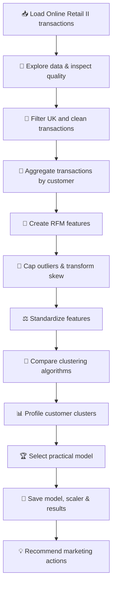
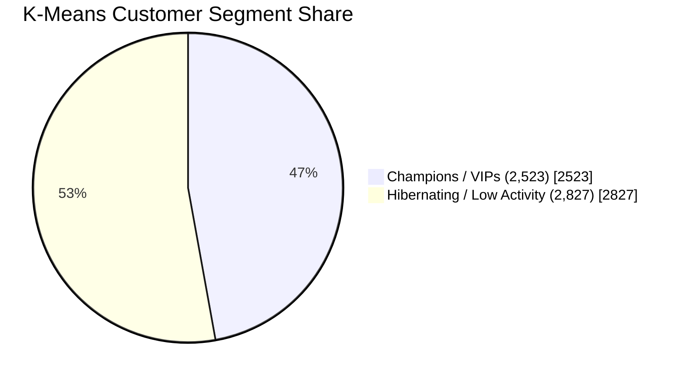
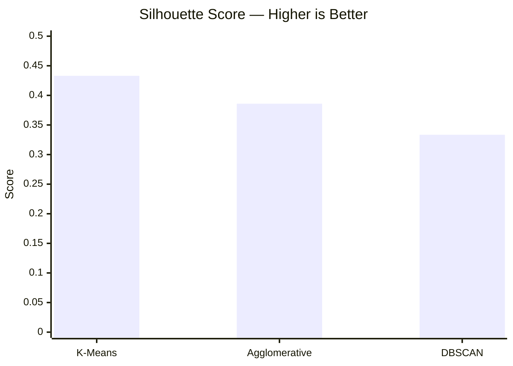
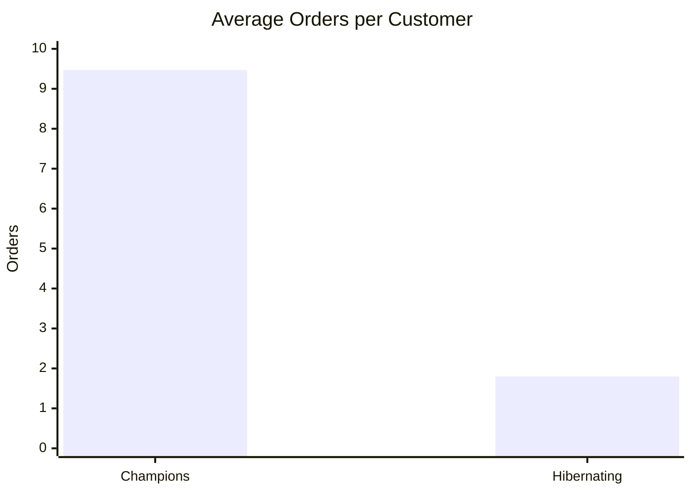

# 🛍️ Customer Segmentation with Unsupervised Learning

> **Turning retail transaction history into actionable customer groups.**  
> A practical data science project using **RFM analysis**, feature engineering, and three clustering algorithms to help an e-commerce marketing team understand customer behaviour and design more relevant campaigns.

<p align="center">
  
  
  
  
  
</p>

---

## 📚 Table of Contents

- [🎯 Project Overview](#-project-overview)
- [💼 Business Problem](#-business-problem)
- [📊 Dataset & Scope](#-dataset--scope)
- [🧭 Project Workflow](#-project-workflow)
- [🧹 Data Preparation](#-data-preparation)
- [🧠 RFM Feature Engineering](#-rfm-feature-engineering)
- [🤖 Models Compared](#-models-compared)
- [🏆 Results & Model Comparison](#-results--model-comparison)
- [👥 Customer Segments](#-customer-segments)
- [📈 Visual Results](#-visual-results)
- [💡 Business Recommendations](#-business-recommendations)
- [🧪 Model Stability & Validation](#-model-stability--validation)
- [🛠️ Tech Stack](#️-tech-stack)
- [📂 Repository Structure](#-repository-structure)
- [🚀 How to Run](#-how-to-run)
- [🔮 Next Steps](#-next-steps)
- [🎓 What I Learned](#-what-i-learned)
- [📬 Project Presentation](#-project-presentation)

---

## 🎯 Project Overview

For this project, I approached customer segmentation as a data science problem for an e-commerce marketing team. Rather than treating every customer the same, I used purchase history to identify groups with similar behaviour.

I built a customer-level **RFM dataset**—Recency, Frequency, and Monetary value—and evaluated three unsupervised learning approaches:

- **K-Means** — a practical baseline that creates compact, interpretable groups.
- **Agglomerative Hierarchical Clustering** — explores customer relationships at different levels of grouping.
- **DBSCAN** — identifies dense groups and can flag unusual customers as noise.

The objective was not simply to find clusters. It was to find customer groups that are measurable, understandable, and potentially useful to a marketing team.

## 💼 Business Problem

A retailer may have thousands of customers but limited time and marketing budget. Sending the same campaign to everyone can lead to irrelevant messaging and missed opportunities.

**The business questions I explored:**

1. Which customers have purchased recently and repeatedly?
2. Which customers contribute higher monetary value?
3. Which customers appear inactive and may need re-engagement?
4. Which clustering approach produces the most useful segmentation for a first marketing pilot?

**Success criteria:** compare cluster quality using multiple internal metrics, review segment profiles, consider model stability and customer coverage, and translate the output into realistic actions.

## 📊 Dataset & Scope

The analysis used the **Online Retail II** transaction dataset. The notebook's recorded run contains:

| Dataset detail | Value |
|---|---:|
| Original transaction rows | 1,067,371 |
| Original columns | 8 |
| Country focus | United Kingdom 🇬🇧 |
| Cleaned UK transaction rows | 725,250 |
| Unique customers after cleaning | 5,350 |
| Unique invoices after cleaning | 33,541 |
| Observed date range in monthly analysis | Dec 2009 – Dec 2011 |
| RFM reference date | 31 Dec 2011 |

The analysis is customer-focused and uses positive quantities, valid prices, and records with a Customer ID.

> **Reproducibility note:** The raw Online Retail II CSV/XLSX was not included with the uploaded project files in this session. I attempted to execute the notebook from top to bottom, but it stopped at the dataset-loading cell because the raw file is missing. This README uses the notebook's saved outputs plus the uploaded results CSV files. Please include the dataset (if licensing and repository-size rules permit) or add instructions for downloading it before claiming a fresh end-to-end run.

## 🧭 Project Workflow



## 🧹 Data Preparation

I documented the cleaning process by tracking how many records remained after each step instead of silently dropping data.

| Cleaning step | Rows remaining | Rows removed at step |
|---|---:|---:|
| Original dataset | 1,067,371 | — |
| Keep United Kingdom only | 981,330 | 86,041 |
| Remove missing Customer ID | 741,301 | 240,029 |
| Remove Quantity ≤ 0 | 725,296 | 16,005 |
| Remove UnitPrice ≤ 0 | **725,250** | 46 |

This leaves a clean transaction base for customer-level analysis.

## 🧠 RFM Feature Engineering

RFM summarizes customer purchasing behaviour using three intuitive variables:

| Feature | Meaning | Interpretation |
|---|---|---|
| **Recency** | Days since the customer's last purchase | Lower is better / more recent |
| **Frequency** | Number of unique invoices | Higher suggests more repeat purchasing |
| **Monetary** | Total customer spend | Higher indicates greater total value |

### Preprocessing choices

- 📅 Fixed reference date: **2011-12-31**
- 🧮 Frequency: number of unique invoices per customer
- 💷 Monetary: total transaction value per customer
- ✂️ Outlier treatment: upper cap using **Q3 + 3 × IQR**
- 📉 Skew handling: `log1p()` applied to Frequency and Monetary
- ⚖️ Scaling: `StandardScaler` applied before distance-based clustering

The final customer dataset contains **5,350 rows**, with one row per customer.

## 🤖 Models Compared

| Algorithm | Why I tested it | Final configuration |
|---|---|---|
| **K-Means** | Simple, scalable baseline with easy-to-profile segments | `k=2`, `n_init=20`, `max_iter=500` |
| **Agglomerative** | Tests hierarchical structure and different linkage strategies | `n_clusters=3`, `linkage='ward'` |
| **DBSCAN** | Finds dense groups and identifies potential noise/outliers | `eps=0.5`, `min_samples=5` |

For K-Means, I reviewed inertia and silhouette values across candidate values of K. For Hierarchical Clustering, I examined a dendrogram and compared linkage methods. For DBSCAN, I used a k-nearest-neighbour distance estimate and tested a parameter grid.

## 🏆 Results & Model Comparison

The final comparison is based on the uploaded `algorithm_metrics_comparison.csv` results.

| Model | Clusters | Silhouette ↑ | Davies–Bouldin ↓ | Calinski–Harabasz ↑ | Noise |
|---|---:|---:|---:|---:|---:|
| 🥇 **K-Means** | 2 | **0.4331** | **0.8662** | **5,880.08** | 0.00% |
| Agglomerative | 3 | 0.3859 | 0.9176 | 5,524.08 | 0.00% |
| DBSCAN | 2 | 0.3335 | 1.0272 | 3,121.37 | 0.49% |

**Metric interpretation:**

- **Silhouette Score:** higher values indicate better-defined separation and cohesion.
- **Davies–Bouldin Index:** lower values generally indicate better separation between clusters.
- **Calinski–Harabasz Index:** higher values indicate stronger between-cluster separation relative to within-cluster dispersion.
- **Noise:** percentage of customers DBSCAN did not assign to a regular cluster.

K-Means led on all three reported internal metrics in this comparison and assigned every customer to a cluster.

## 👥 Customer Segments

### K-Means — selected baseline

The two K-Means clusters were profiled using the actual customer-level output file.

| Segment | Customers | Share | Avg. Recency (days) | Avg. Orders | Avg. Spend | Persona label |
|---|---:|---:|---:|---:|---:|---|
| Cluster 1 | 2,523 | 47.16% | 90.49 | 9.47 | £3,219.12 | 🌟 Champions / VIPs |
| Cluster 0 | 2,827 | 52.84% | 342.30 | 1.80 | £478.47 | 💤 Hibernating / Low Activity |

**What this suggests:** the model separates a relatively active, higher-value group from a larger group with less recent and less frequent purchasing behaviour.

### Agglomerative Hierarchical Clustering

| Cluster | Customers | Avg. Recency | Avg. Orders | Avg. Spend | Persona label |
|---|---:|---:|---:|---:|---|
| 1 | 1,488 | 77.81 days | 12.91 | £4,498.76 | 🌟 Champions / VIPs |
| 2 | 2,110 | 109.34 days | 2.99 | £824.22 | 🛒 Recent / New Customers |
| 0 | 1,752 | 484.86 days | 1.97 | £594.30 | 💤 Hibernating / Low Activity |

### DBSCAN

| Cluster | Customers | Avg. Recency | Avg. Orders | Avg. Spend | Persona label |
|---|---:|---:|---:|---:|---|
| 0 | 3,859 | 163.05 days | 7.10 | £2,317.00 | 🔁 At-Risk Loyal Customers |
| 1 | 1,465 | 378.87 days | 1.00 | £302.38 | 💤 Hibernating / Low Activity |
| Noise | 26 | 450.04 days | 4.15 | £3,469.39 | ⚠️ Review separately |

Persona names are descriptive interpretations of the observed averages—not labels supplied by the algorithm. They should be validated before a real campaign.

## 📈 Visual Results

### K-Means customer distribution



### Algorithm silhouette comparison



### K-Means segment profile



> Values in the charts are from the uploaded result artifacts and saved notebook output. Visuals are intended as quick portfolio summaries; the notebook contains the detailed exploratory plots and model diagnostics.

## 💡 Business Recommendations

Based on the observed profiles, I would treat this as a **pilot segmentation**, not an automatic campaign strategy.

| Segment | Potential marketing action | Goal |
|---|---|---|
| 🌟 Champions / VIPs | Early access, loyalty perks, appreciation offers, product recommendations | Retain high-value customers and encourage repeat purchases |
| 💤 Hibernating / Low Activity | Win-back email, carefully tested incentive, personalised reminder | Re-engage customers who have not purchased recently |
| 🛒 Recent / New Customers (hierarchical view) | Onboarding, complementary product recommendations, second-purchase incentive | Build repeat-purchase habits |
| 🔁 At-Risk Loyal Customers (DBSCAN view) | Reminders, replenishment prompts, relevant offers | Encourage customers with prior activity to return |
| ⚠️ DBSCAN Noise | Review individually or with a separate rule-based approach | Avoid forcing unusual behaviour into a broad segment |

**Recommended first step:** launch a small, controlled campaign pilot using the K-Means baseline. Measure conversion, incremental revenue, repeat purchases, unsubscribe rate, and campaign cost. Use an A/B test to determine whether the segmentation actually improves outcomes.

## 🧪 Model Stability & Validation

- K-Means was evaluated across five random states: **0, 7, 21, 42, and 99**.
- Recorded silhouette mean: **0.4331**
- Recorded silhouette standard deviation: **0.0000**
- Adjusted Rand Index between K-Means and Agglomerative labels: **0.325**

The stability check was consistent for the tested K-Means setup. The lower agreement between K-Means and Agglomerative clustering also shows that different algorithms capture customer structure differently. Cluster quality should therefore be considered alongside interpretability, coverage, and business usefulness.

## 🛠️ Tech Stack

| Tool / Library | Use |
|---|---|
| 🐍 Python | Analysis and workflow implementation |
| 🧮 Pandas & NumPy | Data cleaning, aggregation, feature engineering |
| 📊 Matplotlib & Seaborn | EDA and result visualization |
| 🤖 Scikit-learn | Scaling, clustering, metrics, stability checks |
| 🌳 SciPy | Hierarchical linkage and dendrograms |
| 📓 Jupyter Notebook | Reproducible analysis and narrative |
| 💾 Joblib | Save/load fitted model and scaler |

## 📂 Repository Structure

```text
customer-segmentation-unsupervised-learning/
├── CustomerSegmentation_UnsupervisedLearning.ipynb
├── README.md
├── requirements.txt
├── summary_report.md
├── algorithm_metrics_comparison.csv
├── customer_rfm_clusters.csv
├── customer_segmentation_model.pkl
├── rfm_scaler.pkl
└── data/
    └── online_retail_II.csv  # provide locally; dataset is not included here
```

## 🚀 How to Run

### 1. Clone the repository

```bash
git clone https://github.com/<your-username>/customer-segmentation-unsupervised-learning.git
cd customer-segmentation-unsupervised-learning
```

### 2. Create an environment and install dependencies

```bash
python -m venv .venv
# Windows
.venv\Scripts\activate
# macOS/Linux
source .venv/bin/activate

pip install -r requirements.txt
```

### 3. Add the dataset

Place the Online Retail II CSV/XLSX file next to the notebook, using one of the filenames the notebook checks, or update the dataset path in the loading cell. Confirm the dataset's licence and attribution requirements before redistributing it.

### 4. Open and execute the notebook

```bash
jupyter notebook
```

Open the notebook and run all cells from top to bottom. The notebook creates the cleaned customer RFM data, compares clustering algorithms, generates profiles, and saves the model/scaler and result tables.


## 🎓 What I Learned

This project helped me practise the full unsupervised-learning workflow—not just fitting a model. I learned how important cleaning and feature design are before clustering, why skewed retail data needs thoughtful preprocessing, and why comparing several metrics gives a more balanced view than relying on one score.

Most importantly, I learned that **a cluster is only useful when I can explain what it represents and what a business could reasonably do with it**. The next stage is to test those ideas with real campaign outcomes.

## 📬 Project Presentation


---

<p align="center"><b>Thanks for taking a look at my project! 🙌</b><br>Feedback and suggestions are welcome.</p>
